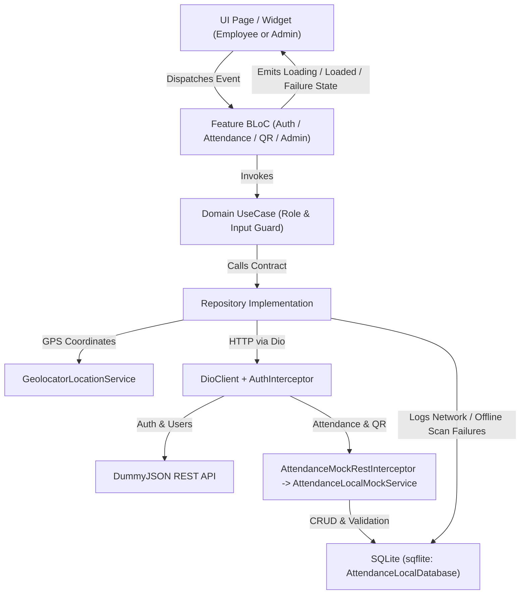

# Smart QR-Based Attendance Management App

A Flutter mobile application for smart employee attendance management powered by **time-limited (30s) HMAC-SHA256 signed QR codes**, **GPS & geofence verification**, **Clean Architecture**, **strict BLoC state management (`flutter_bloc`)**, **Dio REST API integration**, **SQLite (`sqflite`) persistence**, **GetIt**, **GoRouter**, and **Flutter Secure Storage**.

---

## 1. Project Overview & Assessment Requirements Mapping

| Assessment Requirement | Implementation in This Project |
| --- | --- |
| Employee authentication & session handling | `AuthBloc` authenticates via DummyJSON (`POST /auth/login`, `GET /auth/me`), persists tokens in `flutter_secure_storage`, handles `401` expiry via `AuthInterceptor`, and surfaces sign-out feedback. |
| Dynamic time-limited QR code generation | Admin-only `QRBloc` + `AdminQrGeneratorPage` issues 30-second QR codes (`qr_flutter`) with unique `sessionId`, cryptographic `nonce`, timestamps, optional geofence, and live countdown ring. |
| Camera QR scanning & check-in/check-out | `QrScannerPage` (`mobile_scanner` + manual payload fallback) captures live GPS via `geolocator` and submits attendance through `QRBloc` -> `QrAttendanceRepositoryImpl`. |
| Expiry, replay & duplicate validation | Backend service validates HMAC signature -> 30s expiry -> superseded session / consumed nonce -> 250m geofence -> duplicate same-day check-in / check-out-without-check-in rules. |
| Timestamp & GPS capture | Authoritative server UTC timestamp plus check-in / check-out GPS coordinates (`lat`, `lng`, accuracy) and geofence compliance saved in SQLite. |
| Personal dashboard & attendance history | `AttendanceBloc` loads today's check-in/out status, work summary KPIs, date-range and status filters (`All`, `Completed`, `Checked In`), and GPS/time details. |
| Admin attendance console & audit log | `AdminBloc` + `AdminDashboardPage` displays Present / Late / Active / Completed / Absent counts, per-employee GPS & map launch (`url_launcher`), geofence badges, search/date filters, and a **Failed Attempts** tab. |
| Network failure & unauthorized handling | Typed `AppException` / `Failure` / `Result<T>` pipeline, `AuthInterceptor` (`401` sign-out), role guards in UI/Router/Domain/Repository/API, and SQLite logging of rejected & offline/network attempts. |

---

## 2. Setup Instructions

### Prerequisites
- **Flutter SDK**: verified on **Flutter `3.38.2` (`channel stable`) / Dart `3.10.0`** (`environment: sdk: ^3.10.0` in `pubspec.yaml`)
- Android Studio / Android SDK (`minSdk` configured for Android), Xcode (iOS/macOS), or Google Chrome (Web)

### Install & Verify
```bash
flutter pub get
flutter analyze
flutter test
```

### Run the Application
```bash
# Android emulator / physical device (or iOS simulator)
flutter run

# Web target (supports DummyJSON auth, QR generation, Admin Console, and manual QR scan input)
flutter run -d chrome
```

*(Optional) Point `AttendanceRemoteDataSource` to an external REST backend such as MockAPI.io instead of the default mock REST interceptor:*
```bash
flutter run --dart-define=ATTENDANCE_API_URL=https://<your-id>.mockapi.io/api/v1
```

### Demo Credentials (Live DummyJSON API)
The sign-in screen includes one-tap demo chips that authenticate live against `https://dummyjson.com/auth/login`:

| Role | Email | Password | Access Scope |
| --- | --- | --- | --- |
| **Admin** | `emily.johnson@x.dummyjson.com` | `emilyspass` | Admin Console (Attendance + Failed Attempts), 30s QR Kiosk, Profile |
| **Employee** | `evelyn.gonzalez@x.dummyjson.com` | `evelyngpass` | Employee Dashboard, Scan QR (Check-In / Check-Out), Attendance History, Profile |

---

## 3. Architecture Overview

### Clean Architecture Layers
Every feature is organized into three strict layers:
- **`domain`**: Pure Dart entities, repository contracts (`abstract class`), and single-purpose use cases returning `Future<Result<T>>` (e.g., `LoginUseCase`, `GenerateQrSessionUseCase`, `SubmitQrAttendanceUseCase`, `GetAdminDashboardUseCase`, `GetFailedAttemptsUseCase`).
- **`data`**: JSON models, remote/local data sources (`AuthRemoteDataSource`, `AttendanceRemoteDataSource`, `QrRemoteDataSource`, `AdminRemoteDataSource`, `AttendanceLocalMockService`, `AttendanceLocalDatabase`), and repository implementations mapping exceptions to typed `Failure` objects.
- **`presentation`**: BLoCs (`AuthBloc`, `AttendanceBloc`, `QRBloc`, `AdminBloc`), `Equatable` events/states, pages, and stateless reusable widgets. No business state uses `setState`, `Provider`, `Riverpod`, or `GetX`.

### Folder Structure
```text
lib/
├── core/
│   ├── constants/        # api_constants.dart, app_constants.dart, storage_keys.dart
│   ├── di/               # injection_container.dart (GetIt service locator)
│   ├── errors/           # exceptions.dart, failures.dart, result.dart
│   ├── network/          # dio_client.dart, auth_interceptor.dart,
│   │                     # attendance_mock_rest_interceptor.dart, network_exceptions.dart
│   ├── router/           # app_router.dart (GoRouter + ShellRoute + role redirect guards)
│   ├── services/         # secure_storage_service.dart, location_service.dart
│   ├── theme/            # app_theme.dart (Material 3 corporate light theme)
│   ├── utils/            # qr_security_utils.dart, geo_utils.dart, date_time_utils.dart, validators.dart
│   └── widgets/          # app_error_widget.dart, empty_state_widget.dart, loading_widget.dart, status_badge.dart
├── features/
│   ├── authentication/
│   │   ├── data/         # datasources, models, repositories
│   │   ├── domain/       # entities, repositories, usecases
│   │   └── presentation/ # AuthBloc, LoginPage, ProfilePage, SplashPage, LoginFormCard
│   ├── attendance/
│   │   ├── data/         # AttendanceLocalDatabase (sqflite), AttendanceLocalMockService, remote DS, models, repo
│   │   ├── domain/       # AttendanceRecordEntity, AttendanceSummaryEntity, usecases
│   │   └── presentation/ # AttendanceBloc, EmployeeDashboardPage, AttendanceHistoryPage, widgets
│   ├── qr_attendance/
│   │   ├── data/         # QrRemoteDataSource, QrSessionModel, QrAttendanceRepositoryImpl
│   │   ├── domain/       # QrSessionEntity, QrScanResultEntity, usecases (Generate, Submit, Validate)
│   │   └── presentation/ # QRBloc, AdminQrGeneratorPage, QrScannerPage, widgets
│   └── admin/
│       ├── data/         # AdminRemoteDataSource, FailedAttemptModel, AdminRepositoryImpl
│       ├── domain/       # AdminDashboardSummaryEntity, FailedAttemptEntity, usecases
│       └── presentation/ # AdminBloc, AdminDashboardPage, FailedAttemptsList, EmployeeAttendanceCard, modal
└── main.dart
```

### BLoC Flow & Role Guards
- **`AuthBloc`**: Drives app startup (`AuthCheckRequested`), login (`AuthLoginSubmitted`), profile refresh, manual logout (`AuthLogoutRequested`), and reactive `401` forced logout (`AuthUnauthorizedDetected`). `GoRouter` listens to `AuthBloc` and enforces role routing (`/admin*` for `admin`, `/dashboard`, `/history`, `/scan` for employees).
- **`QRBloc`**: Manages both Admin 30s QR countdown sessions (`QrSessionGenerateRequested`, `QrCountdownTicked`) and Employee scanning (`QrScannerInitialized`, `QrLocationRequested`, `QrCodeScanned`).
- **`AttendanceBloc`**: Loads employee today status and filtered attendance history (`AttendanceDashboardRequested`, `AttendanceHistoryRequested`, filters).
- **`AdminBloc`**: Loads daily team attendance metrics, filters/search, employee profile details, and rejected scan logs (`AdminDashboardRequested`, `AdminFailedAttemptsRequested`).

### Data-Flow Diagram


---

## 4. QR Security Design

Each dynamic QR code encodes a JSON payload signed by `QrSecurityUtils.createSignedPayload`:
```json
{
  "app": "smart_qr_attendance",
  "sessionId": "sess_1794484800000_a1b2c3d4",
  "nonce": "9f8e7d6c5b4a3210",
  "location": "HQ Main Campus - Gate A",
  "issuedAt": 1794484800000,
  "expiresAt": 1794484830000,
  "lat": 12.9716,
  "lng": 77.5946,
  "radiusM": 250.0,
  "signature": "<64-char HMAC-SHA256 hex digest>"
}
```

Security controls enforced end-to-end:
1. **HMAC-SHA256 Signing (`crypto`)**: Computes `HMAC-SHA256` over the canonical string `app|sessionId|nonce|locationName|issuedAtMs|expiresAtMs|lat|lng|radiusM` using `AppConstants.qrServiceSecret` and verifies via a constant-time comparison (`_constantTimeEquals`), preventing payload tampering with expiry timestamps, session IDs, location names, or geofence coordinates.
2. **Strict 30-Second Expiry (`qrValiditySeconds = 30`)**: QR payloads expire 30 seconds after server `issuedAtMs`; generating a new session marks previous active sessions inactive (`SESSION_INACTIVE`).
3. **Cryptographic Nonce & Replay Protection**: Consumed `nonce|userId|action` keys are persisted in SQLite (`used_nonces`) after a successful check-in or check-out, rejecting reused QR captures (`QR_REPLAY`).
4. **Geofence Verification (250m)**: When geofencing is enabled on QR generation, `GeoUtils.calculateDistanceMeters` (`Geolocator.distanceBetween`) rejects scans outside the configured radius (`defaultGeofenceRadiusMeters = 250.0` meters) and records compliance metadata (`geofenceEnforced`, `geofenceRadiusMeters`) on attendance records.
5. **Exact Scan Validation Order**:
   1. Bearer token & role verification (`401` / `403`)
   2. HMAC-SHA256 signature verification (`QR_MALFORMED` / `QR_INVALID_SIGNATURE`)
   3. 30-second expiry check (`QR_EXPIRED`)
   4. Inactive session / consumed nonce replay check (`SESSION_INACTIVE` / `QR_REPLAY`)
   5. Valid GPS coordinates & 250m geofence radius check if enabled (`LOCATION_REQUIRED` / `OUTSIDE_GEOFENCE`)
   6. Attendance state rules blocking duplicate check-in on the same day (`DUPLICATE_CHECK_IN` / `ALREADY_CHECKED_OUT`) and check-out without a prior check-in (`NO_ACTIVE_CHECK_IN`)
   Every failed validation produces a typed `Failure` and logs a `FailedAttemptEntity` (`expired`, `duplicate`, `invalid_signature`, `out_of_range`, `unauthorized`, `network_error`) to SQLite for inspection in the Admin **Failed Attempts** tab.

---

## 5. Error Handling & Offline Strategy

- **Structured Error Pipeline**: All data-source errors throw subclasses of `AppException` (`NetworkException`, `TimeoutException`, `UnauthorizedException`, `ForbiddenException`, `ServerException`, `QrValidationException`, `LocationException`, `CacheException`). Repositories convert them via `mapExceptionToFailure` into immutable `Failure` objects inside `Result<T>` (`Success` / `ResultFailure`).
- **Network Mapping (`NetworkExceptionMapper`)**: Converts Dio timeouts, socket/connection errors, bad certificates, and HTTP `401`/`403`/`409`/`410` wire codes (`QR_EXPIRED`, `QR_INVALID_SIGNATURE`, `OUTSIDE_GEOFENCE`, etc.) into user-friendly, strongly typed failures.
- **Session Expiry (`AuthInterceptor`)**: Attaches stored bearer tokens from `FlutterSecureStorageService` and intercepts any `401` on protected requests, clearing credentials and signaling `AuthBloc` to return to `/login`.
- **Persistence & Offline Behavior**:
  - **Mobile/Desktop**: Attendance records, QR sessions, consumed nonces, and `failed_attempts` persist locally in SQLite (`qr_attendance.db`, schema v2 via `SqliteAttendanceDatabase`).
  - **Web**: Automatically falls back to `SharedPrefsAttendanceDatabase` when `kIsWeb` is true since `sqflite` does not run in browser runtimes.
  - **Offline/Network Scan Failures**: If `submitQrAttendance` fails with `NetworkFailure`, `TimeoutFailure`, or `LocationFailure`, `QrAttendanceRepositoryImpl` records a `FailedAttempt` (`network_error` or `out_of_range`) directly in `AttendanceLocalDatabase` so administrators retain an audit trail even when network calls fail. DummyJSON login and `/users` directory calls require internet access; if `/users` is unreachable offline, Admin **Failed Attempts** falls back cleanly to displaying employee ID badges (`EMP-XXX`).

---

## 6. Known Limitations & Future Improvements

- **Simulated Attendance Backend**: `AttendanceLocalMockService` simulates backend attendance endpoints on-device when `ATTENDANCE_API_URL` is unset. In production, deploy real server-side REST microservices (or full MockAPI/custom backend) as the single source of truth across all employee devices.
- **Client-Side Signing Secret**: `AppConstants.qrServiceSecret` is co-located in the client binary because QR generation/verification runs inside the mock backend service. In production, the HMAC signing key must live exclusively on the backend KMS/environment, issuing signed payloads only to authenticated Admin sessions and verifying scans strictly server-side.
- **Refresh Token Rotation**: DummyJSON issues a JWT `accessToken` + `refreshToken`, and the current session interceptor clears storage cleanly on `401 Unauthorized`; production hardening should add silent `POST /auth/refresh` retry queueing before forcing sign-out.
- **Anti-Spoofing & Device Attestation**: Client-supplied GPS (`geolocator`) can be spoofed on rooted/jailbroken devices; future iterations should check mock-location flags, integrate Play Integrity / App Attest, and resolve server-trusted kiosk beacons or Wi-Fi BSSID verification.
# Qr_attendance_app
